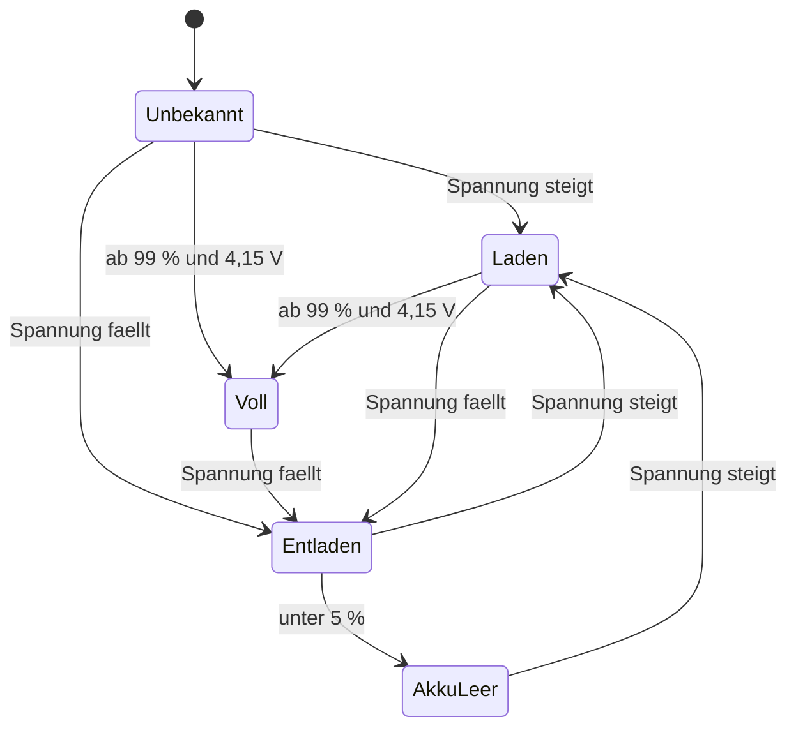
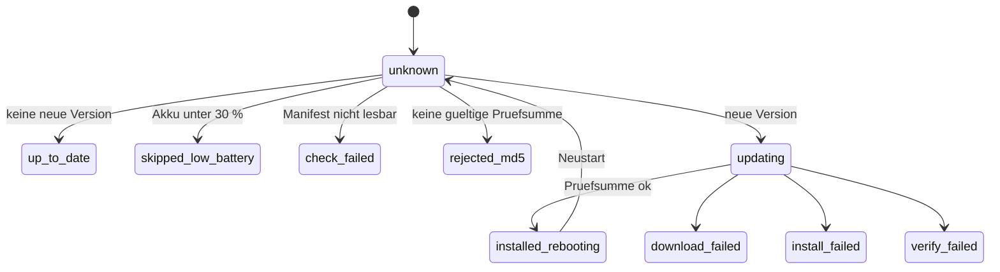

# Epaper-Display

ESP32-Bat-Pro-Firmware für ein Waveshare 4.2" E-Paper-Dashboard (Türanzeige:
Wetter, Termine, Einkaufsliste, Akkustand) plus zugehörige Home-Assistant-
Integration (`custom_components/epaper_display/`, siehe dortige
[README](custom_components/epaper_display/README.md)).

Keine Secrets im Repo: WLAN-Zugangsdaten und die Webhook-URL der HA-
Integration werden einmalig per USB über die serielle Setup-Shell gesetzt
und landen im NVS des ESP32 (`Preferences`), nicht im Quellcode.

## Setup-Shell

Bei USB-Kaltstart (nicht nach Deep-Sleep-Wakeup) öffnet sich 3 Sekunden ein
Zeitfenster für die Shell - ein beliebiger Tastendruck im seriellen Monitor
(115200 Baud) öffnet sie. Wurden noch nie gültige Settings gespeichert,
öffnet sie sich sofort ohne Wartezeit.

Befehle:

```
wifi ssid <wert>   WLAN-SSID setzen
wifi pass <wert>   WLAN-Passwort setzen
url <wert>         Webhook-URL der HA-Integration, z.B.
                    https://home.example.de/api/webhook/<webhook_id>
show               aktuelle Werte anzeigen (Passwort maskiert)
save               Werte ins NVS schreiben
reboot             Neustart
```

Nach `save` + `reboot` verbindet sich das Gerät normal und fragt bei jedem
Wakeup den Webhook nach neuem Display-Inhalt und einem Firmware-Update ab.

## Firmware-Updates (OTA über HACS)

Firmware-Updates kommen über denselben Webhook wie der Display-Inhalt
(`?firmware=version` / `?firmware=bin`, siehe Integrations-README) - ein
Update wird nur angewendet, wenn der Akku über 30 % liegt und die MD5-Summe
passt. `release.sh` (dieses Verzeichnis) erhöht `FirmwareVersionCode`
(`include/OtaUpdate.h`) und die HACS-Integrationsversion, baut die Firmware
und legt `firmware.bin` + `version.json` in
`custom_components/epaper_display/firmware/` ab. Danach: `git diff` prüfen,
committen, pushen - ein HA-Nutzer bekommt das neue Firmware-Image dann über
ein normales HACS-Integrations-Update.

Kein automatisches Rollback: schlägt ein Release fehl, hilft nur ein
USB-Reflash.

## Battery-Empty-Modus

Unter 5 % Akku (`EpaperBatteryEmptyPercent` in `src/main.cpp`) überspringt
das Gerät WLAN, Display-Update und OTA-Check komplett und geht sofort
wieder in den Deep Sleep - mit einem auf 1 Stunde verlängerten Zyklus
(`EpaperBatteryEmptySleepSeconds`) statt der üblichen 10 Minuten, um die
Restladung zu strecken. Sobald der Akku wieder über der Schwelle liegt,
läuft der normale Betrieb automatisch weiter.

## Zustaende und Intervalle



| Zustand (`powerState`) | Bedingung | Statusmeldung | Display + Update-Check |
|---|---|---|---|
| `charging` | Spannung steigt | ca. jede Minute | alle 10 min (nicht unter 5 %) |
| `full` | ab 99 % und 4,15 V, nicht fallend | ca. jede Minute | alle 10 min |
| `discharging` | Spannung faellt | alle 10 min | alle 10 min |
| `unknown` | seit Neustart keine klare Aenderung | einmal nach 1 min, dann alle 10 min | alle 10 min |
| Akku leer | unter 5 %, nicht ladend | keine, Aufwachen stuendlich | keine |

Der Zustand wird allein aus der Akkuspannung abgeleitet (`include/PowerSource.h`):
Steigt sie um mindestens 30 mV ueber die Referenz, gilt `charging`, faellt sie
um 30 mV darunter, `discharging`. Dazwischen bleibt der Zustand. Gemessen wird
einmal pro Wachzyklus vor dem WLAN-Start. An- und Abstecken wird erst beim
naechsten Aufwachen bemerkt; Temperatur oder Last koennen das Ergebnis
verfaelschen.

Update-Status (`otaState`):



## Display-Refresh

Alle 10 Minuten wird der Inhalt abgeholt, gezeichnet wird nur, wenn er sich
geaendert hat (Header `X-Epaper-Content`, ohne Uhrzeit), nach einem Neustart
oder spaetestens nach 24 Stunden. "Stand:" zeigt also die letzte Aenderung.
Vor dem Refresh wird das WLAN abgeschaltet. Antwortet das Panel 60 s lang
nicht, wird abgebrochen und `displayState` = `timeout` gemeldet.

## Build

```
platformio run -e esp-bat-pro
```
